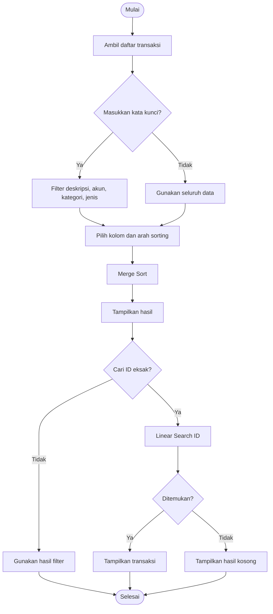

# Algoritma Sorting dan Searching PFMS

## Pseudocode — Merge Sort

```text
MERGE_SORT(A):
    jika panjang(A) <= 1:
        kembalikan salinan A
    tengah = floor(panjang(A) / 2)
    kiri = MERGE_SORT(A[0:tengah])
    kanan = MERGE_SORT(A[tengah:akhir])
    hasil = array kosong
    selama kiri dan kanan belum habis:
        jika kiri[0] <= kanan[0]:
            pindahkan elemen pertama kiri ke hasil
        selain itu:
            pindahkan elemen pertama kanan ke hasil
    gabungkan sisa kiri dan kanan ke hasil
    kembalikan hasil
```

## Pseudocode — Linear Search

```text
LINEAR_SEARCH(A, target):
    untuk i dari 0 sampai panjang(A)-1:
        jika A[i] cocok dengan target:
            kembalikan i
    kembalikan -1
```

## Pseudocode — Binary Search

Prasyarat: array telah diurutkan memakai comparator yang sama.

```text
BINARY_SEARCH(A, target):
    low = 0
    high = panjang(A)-1
    selama low <= high:
        mid = low + floor((high-low)/2)
        jika A[mid] == target:
            geser ke kiri untuk menemukan indeks cocok pertama
            kembalikan indeks tersebut
        jika A[mid] < target:
            low = mid+1
        selain itu:
            high = mid-1
    kembalikan -1
```

## Flowchart alur pencarian dan pengurutan



## Kompleksitas

| Algoritma     |       Best |    Average |      Worst | Memori tambahan |
| ------------- | ---------: | ---------: | ---------: | --------------: |
| Merge sort    | O(n log n) | O(n log n) | O(n log n) |            O(n) |
| Linear search |       O(1) |       O(n) |       O(n) |            O(1) |
| Binary search |       O(1) |   O(log n) |   O(log n) |            O(1) |

Implementasi ada di `src/lib/algorithms.ts`; unit test ada di `tests/algorithms.test.ts`.
